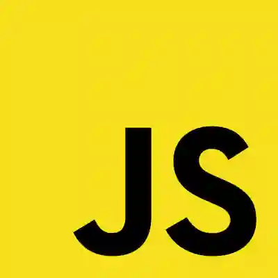
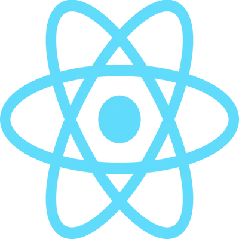
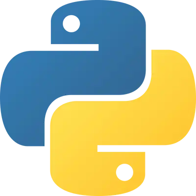
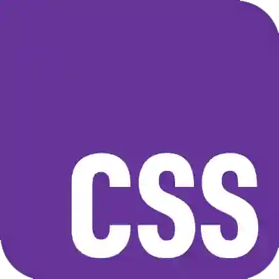
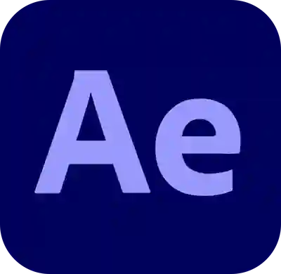
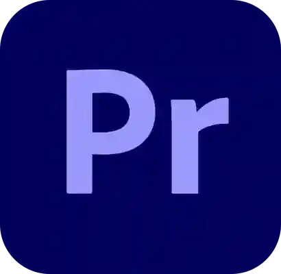
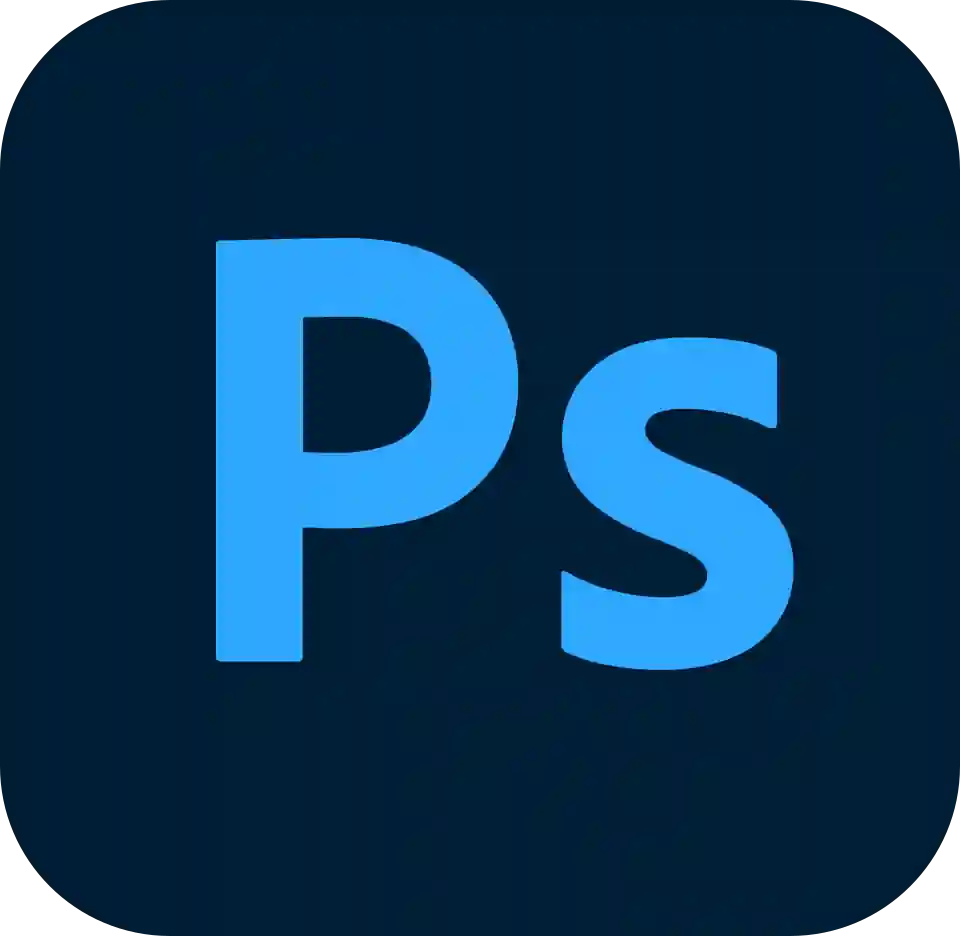
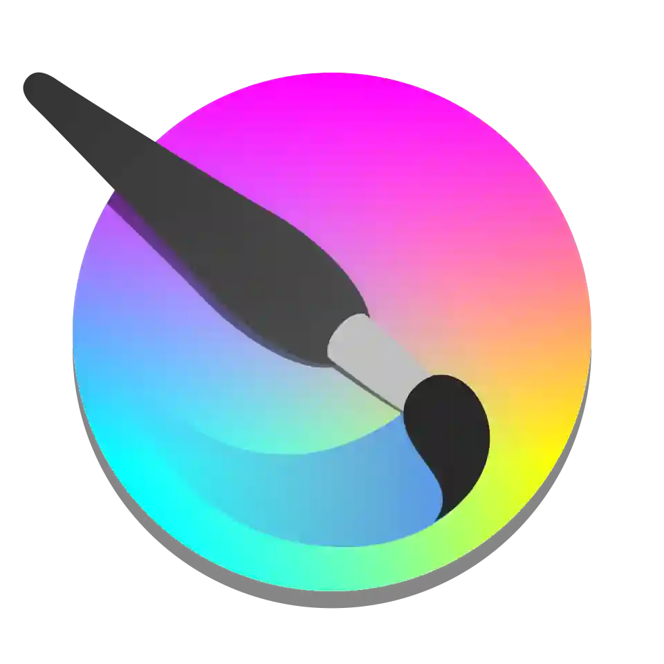
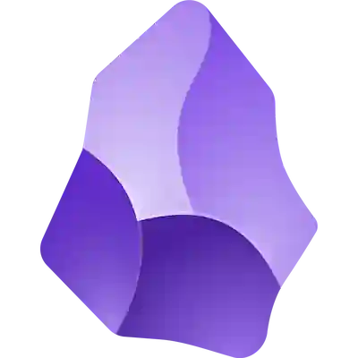

## Hi there 👋, I'm Ramón 
#### llustrator · Motion Designer · Software Developer

---

## 📝 About Me
- 🎓 Computer Engineering student at UTN
- 🎨 Digital illustrator working mainly in Krita
- 🎞️ Motion graphics animator & editor

## 🌱 I'm currently learning
  -  TypeScript /  JavaScript
  -  React
  -  Git

## 🛠️ Skills
- Languages:   TypeScript /  JavaScript,  Python,  CSS
- Frameworks/ Libraries:  React
- Tools:  After Effects,  Premiere,  Photoshop,  Krita,  Obsidian,  Git

## 🗃️ Currrently Proyects
- Visualizador de Materias – a simple academic planner built with modern frontend tools.
- Ranuuki’s Gallery – an ongoing collection of my digital illustration and animation work.